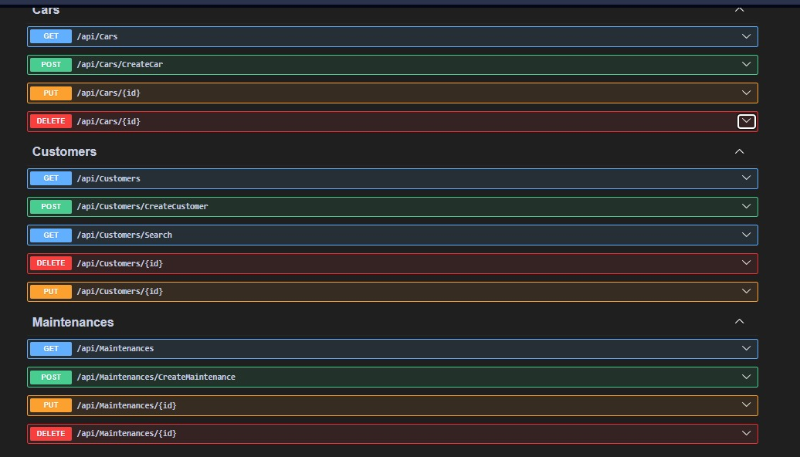

# CarServiceTracker

Web API for tracking vehicles, customers, and service interventions in an auto repair shop.

## Technologies

- **ASP.NET Core 9** – Web API
- **Entity Framework Core 9** – ORM, SQL Server
- **JWT** – authentication
- **BCrypt.Net** – password hashing
- **Swagger** – API documentation

## Features

- **Accounts** – registration and login (JWT token)
- **Customers** – CRUD, search (name, phone, email)
- **Vehicles** – CRUD, linked to customer (make/model, status)
- **Maintenance** – CRUD, linked to vehicle (date, description, parts, cost, mechanic)

